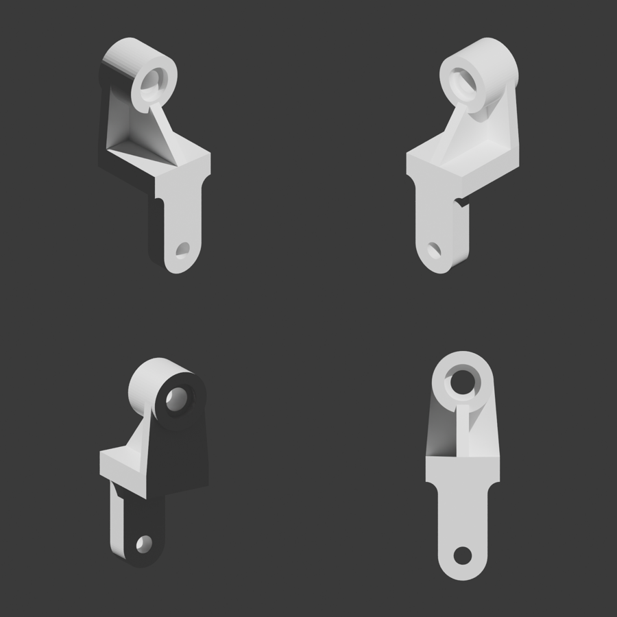

# Projekt 4 – Algebra Boole'a na obiektach technicznych (Blender)

Osobny projekt laboratoryjny (nie jest częścią aplikacji *mini-zoom*, leży na osobnej gałęzi `blender-lab4`).

## Pliki do pobrania

| Plik | Co to jest |
|---|---|
| `output/projekt4_wspornik.blend` | **Gotowy plik Blendera**: kolekcje `obiekt_mods` (model + wycięcia z modyfikatorami) i `obiekt_final` (bryła po apply i Union), blueprint spakowany w pliku |
| `output/wspornik_final.obj`, `.stl` | Sama bryła końcowa (do importu w starszym Blenderze / druku 3D) |
| `output/projekt4_polowa.blend` | **Wersja zrobiona do połowy** (stan w trakcie pracy – patrz niżej) |
| `build_half.py` | Skrypt budujący wersję do połowy |
| `podglad_polowa.png` | Podgląd wersji do połowy (z siatką) |
| `build_model.py` | Skrypt, który buduje cały model od zera (te same kroki co niżej) |
| `blueprint.png` | Rysunek referencyjny |
| `podglad.png` | Rendery modelu z 4 stron |

**Jak pobrać z GitHuba:** wejdź w repozytorium → przełącz gałąź na `blender-lab4` → `output/projekt4_wspornik.blend` → przycisk *Download raw file*.
Plik zapisany w Blenderze 5.2 – otworzy się w Blenderze 4.5 LTS i nowszych. W starszej wersji: uruchom `build_model.py` (zakładka *Scripting* → *Open* → *Run Script*, `blueprint.png` musi leżeć obok skryptu) albo zaimportuj `.obj`.

Po otwarciu `.blend` kliknij u góry zakładkę **Blueprint** – po lewej Image Editor z rysunkiem, po prawej Viewport 3D (zad. 4.1).



## Wersja zrobiona do połowy – `projekt4_polowa.blend`

Zrobione: 4.1, 4.2 i 4.3 (podstawa, część dolna z R10/R20, tylna ścianka zwężona do cylindra, podpórka/żebro, cylinder ustawiony). Niezrobione: otwory, Boolean, oczyszczanie (4.4, 4.5).
Po czym widać, że to praca w toku:
* obiekt nadal nazywa się `Cube` (nie przemianowany), plik otwiera się w **Edit Mode** z zaznaczonymi ścianami żebra,
* modyfikator **Mirror** jest jeszcze niezatwierdzony (edytowana tylko połowa), widać wszystkie pętle cięć (X = 5/20/25, Y = 10/20/60, Z = −60) i bevele 16 segmentów,
* żebro jest wyciągnięte, ale jeszcze nachodzi na cylinder i ma złą grubość (do poprawki), cylinder to osobny obiekt `Cylinder`,
* 3D kursor stoi już w miejscu otworu ⌀15 (0, 10, −60) – przygotowanie do 4.4,
* brak kolekcji `wycięcia`, `obiekt_mods`, `obiekt_final`,
* lista postępu w tekście `POSTEP_PRACY.txt`.

**Jakie zakładki otworzyć (u góry okna Blendera):**
1. **Layout** – widok startowy: Viewport 3D w Edit Mode, w Outlinerze kolekcja `model` z `Cube` i `Cylinder`; po prawej *Properties* → ikona klucza 🔧 (*Modifiers*) pokazuje niezatwierdzony Mirror.
2. **UV Editing** – po lewej Image Editor z blueprintem, po prawej Viewport 3D (to jest układ z zad. 4.1).
3. **Modeling** – wygodna praca na siatce (Edit Mode).
4. **Scripting** – w edytorze tekstu `POSTEP_PRACY.txt` z odhaczonymi i pozostałymi krokami.

W Viewport włączone są nakładki *Wireframe* i *Edge Length*. Przy zaznaczonych krawędziach wyświetlają się ich długości.

## Wymiary odczytane z rysunku [mm]

Jednostki sceny: *Metric*, *Unit Scale* 0.001, *Length* = mm (1 jednostka = 1 mm). Przód podstawy leży na płaszczyźnie XZ (Y = 0), model rośnie w stronę +Y, oś symetrii to płaszczyzna YZ (X = 0).

| Element | Wymiary / położenie |
|---|---|
| Podstawa | 60 (X) × 70 (Y) × 20 (Z); X −30…30, Y 0…70, Z 0…20 |
| Część dolna | szer. 40 (2×R20), grub. 20 (Y 0…20), środek otworu 60 pod spodem podstawy (Z = −60), dół R20, przejście do podstawy R10 |
| Otwór dolny | ⌀15 przelotowy |
| Cylinder | ⌀50 × 40, oś równoległa do Y na wysokości Z = 80 (**60 nad górą podstawy**), Y 35…75 (35 od przodu podstawy) |
| Otwór cylindra | ⌀20 przelotowy, pogłębienie ⌀30 × 6 z obu stron |
| Tylna ścianka | pełna (bez wycięcia), od góry podstawy do osi cylindra Z = 80, grub. 10 (Y 60…70, czyli 25 za przodem cylindra), u dołu szer. 60 (cała podstawa), zwęża się do 50 – styczna do cylindra |
| Podpórka | **pełna ścianka** grub. 10 (środek, X −5…5): skos od przedniej krawędzi podstawy do przodu cylindra, pod skosem wypełniona aż do podstawy, cylindra i tylnej ścianki – bez pustej przestrzeni |

## Wykonanie krok po kroku (ręcznie w Blenderze)

### Zadanie 4.1 – przygotowanie Blendera
1. *File → New → General*, zaznacz kostkę, kamerę i światło → `X` → *Delete*.
2. *Scene Properties → Units*: Unit System *Metric*, Unit Scale `0.001`, Length *Millimeters*. W Viewport → `N` → *View* ustaw *Clip End* np. 5000.
3. Przeciągnij lewą krawędź okna (lub wejdź w zakładkę *UV Editing*), by mieć **Viewport 3D** i **Image Editor** obok siebie.
4. W Image Editor: *Image → Open* → `blueprint.png`.

### Zadanie 4.2 – kształt podstawowy
1. W Outlinerze: PPM → *New Collection* → nazwij `model`.
2. `Shift+A` → *Mesh → Cube*. `Tab` (Edit Mode), zaznacz wszystko `A`, `N` → ustaw wymiary w *Item → Dimensions*: X 60, Y 70, Z 20 (w Object Mode) – albo w Edit Mode przeskaluj tak, by siatka miała X −30…30, Y 0…70, Z 0…20 (przód styczny z płaszczyzną XZ, origin zostaje w World Origin). Jeśli skalowałeś w Object Mode: `Ctrl+A` → *Scale*.
3. `M` → przenieś do kolekcji `model`.
4. Edit Mode → `Ctrl+R` → pętla krawędzi w połowie (płaszczyzna YZ, X = 0). Zaznacz wierzchołki z X < 0 → `X` → *Vertices*.
5. *Modifiers → Add → Generate → Mirror*: Axis **X**, *Bisect* wył., *Clipping* **wł.**, *Merge* **wł.**, 0.01.
6. **Z.4.2.2** – dodaj pętle krawędzi (`Ctrl+R`, potem wpisz wartość przesunięcia) w miejscach wypustek: X = 20 (bok części dolnej), X = 25 (bok tylnej ścianki), X = 5 (żebro), Y = 20 (tył części dolnej), Y = 60 (przód tylnej ścianki).

### Zadanie 4.3 – rozbudowa obiektu bazowego
**4.3.1 Część dolna**
1. Zaznacz na spodzie ścianę X 0…20, Y 0…20 → `E` → wyciągnij w dół o **80** (`E`, `Z`, `-80`).
2. `Ctrl+R` dodaj pętle wyznaczające początek i koniec zaokrągleń (Z = −10 przy podstawie, Z = −60 na środku otworu). Zbędne cięcia usuń: zaznacz → `X` → *Dissolve Edges/Vertices*.

**4.3.2 Zaokrąglenia**
1. Krawędź dolna zewnętrzna (X = 20, Z = −80) → `Ctrl+B` (Bevel), *Width* **20**, *Segments* **16** → po odbiciu daje półokrąg R20.
2. Krawędź wewnętrzna między spodem podstawy a bokiem części dolnej (X = 20, Z = 0) → `Ctrl+B`, *Width* **10**, *Segments* **16** → R10.

**4.3.3 Część górna**
1. (1) Na górze podstawy zaznacz ścianę X 0…25, Y 60…70 → `E` → wyciągnij do Z = 80 (o 60); zewnętrzne górne werteksy przesuń z X = 30 na X = 25 (zwężenie do stycznej z cylindrem) – to tylna ścianka gr. 10.
2. (2) `Shift+A` → *Cylinder*: Vertices 64, Radius 25, Depth 40. Obróć `R X 90`. Ustaw Location: X 0, Y 55, Z 80 (przód na Y = 35). Przenieś do kolekcji `model`. Można też użyć *Snap → Vertex → Closest*.
3. (3) Podpórka: dodaj pętlę Y = 35. Zaznacz na górze podstawy pas ścian X 0…5 od Y = 0 do tylnej ścianki i wyciągnij go razem z tylną ścianką (jeden extrude o 60).
4. (4) Ustaw górne werteksy pasa na skos: Y = 0 → Z = 20 (scal z krawędzią podstawy, `M` → *By Distance*), Y = 10 → Z = 32, Y = 20 → Z = 44, Y = 35 → Z = 62 (przód cylindra, poniżej pogłębienia ⌀30). Pod skosem zostaje **pełna ścianka** – nic nie wycinamy. Brakujące ściany uzupełnij `F` (Fill).
5. (5) Powtórz dla pozostałych kątowników (tylna ścianka styczna do cylindra).

### Zadanie 4.4 – otwory
1. Nowa kolekcja `wycięcia`.
2. Ustaw kursor w środku otworu (`Shift+S` → *Cursor to Selected* na zaznaczonych wierzchołkach albo `N` → *View → 3D Cursor*), potem `Shift+A` → *Cylinder* – pojawi się w miejscu kursora:
   * `otwor_fi20`: R 10, dł. 50, oś Y, środek (0, 55, 80),
   * `poglebienie_fi30x6`: R 15, Y 34…41 (6 mm w głąb cylindra + 1 mm zapasu). Dodaj **Mirror** oś **Y** z *Mirror Object* = Empty w środku cylindra (0, 55, 80) → pogłębienie po obu stronach,
   * `otwor_fi15`: R 7.5, dł. 30, oś Y, środek (0, 10, −60).
3. W Outlinerze wyłącz widoczność kolekcji `wycięcia` (ikonka oka / ekranu).
4. Na **podstawie** i **cylindrze**: *Add Modifier → Generate → Boolean*, **Difference**, *Operand Type* **Collection** → `wycięcia`. (W kolekcji muszą być same siatki – Empty trzymaj poza nią.)

### Zadanie 4.5 – oczyszczenie modelu
1. Utwórz kolekcję `obiekt_mods` i przeciągnij do niej `model` i `wycięcia`.
2. PPM na `obiekt_mods` → *Duplicate Collection* → nazwij `obiekt_final`; ukryj `obiekt_mods`. Dalej pracuj tylko na kopii (w kopii Boolean musi wskazywać na **kopię** kolekcji wycięć).
3. Sprawdź model pod kątem nakładających się ścian (*Edit Mode → Select → Select All by Trait → Non Manifold*, `M` → *Merge by Distance*).
4. *Apply* (`Ctrl+A` → *Apply All Modifiers* / menu modyfikatora → *Apply*): najpierw na obiektach wycięć, potem na cylindrze, potem na podstawie (Mirror, potem Boolean).
5. Na podstawie dodaj **Boolean → Union** z obiektem cylinder → *Apply*. Usuń cylinder (jest już częścią bryły).

Wynik: obiekt `wspornik_final` – jedna zamknięta bryła (0 krawędzi non-manifold, objętość ≈ 242 389 mm³).

## Uruchomienie skryptu
```
blender --background --python build_model.py
```
Wynik trafi do `output/`.
